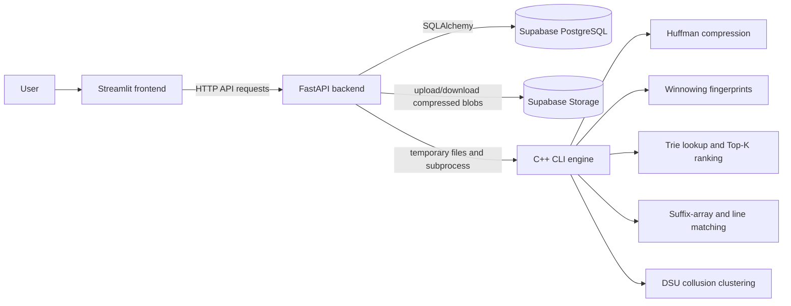
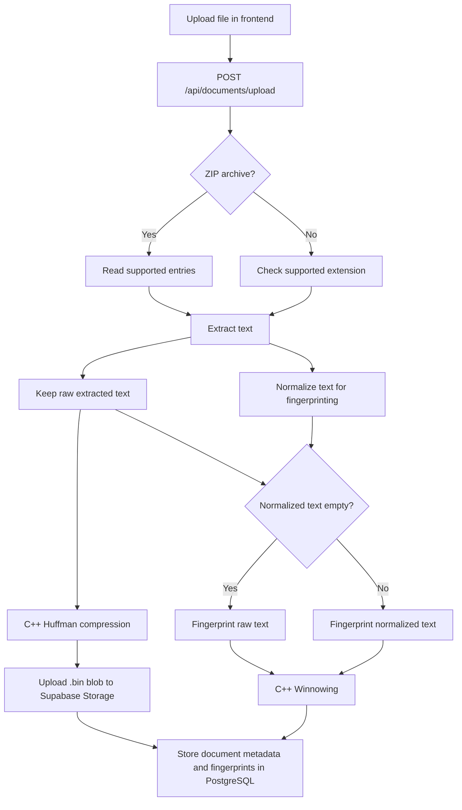
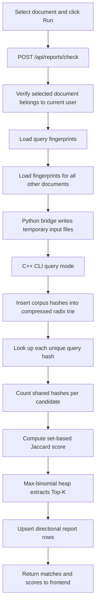
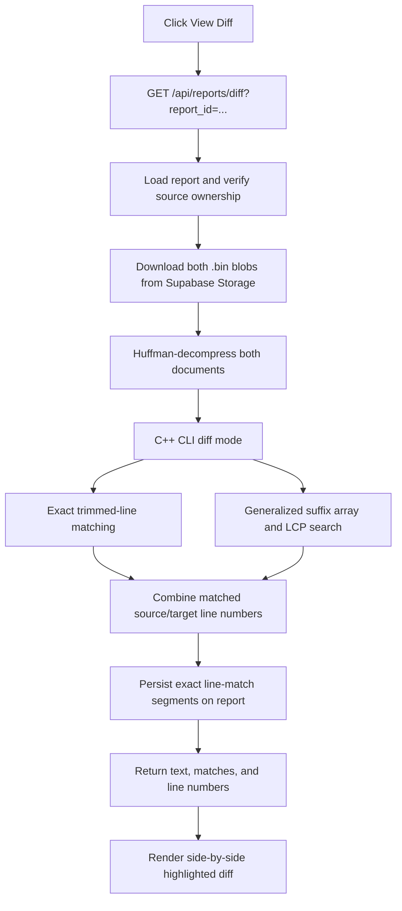

# How the Plagiarism Checker Works

This document describes both the **intended architecture** documented in [`strucutre.md`](./strucutre.md) and the **behavior currently implemented** in the repository. The distinction matters: some components are implemented only partially, as noted in the relevant sections.

## At a glance

The project has three main runtime parts:

- **Streamlit frontend**: lets users authenticate, upload documents, request plagiarism checks, view ranked matches, and inspect a diff.
- **FastAPI backend**: handles authentication, document ingestion, database access, and calls the C++ engine.
- **C++ CLI engine**: implements Huffman compression/decompression, Winnowing fingerprints, candidate lookup and ranking, diff analysis, and DSU clustering.

Supabase is used for authentication, PostgreSQL database storage, and the `compressed_docs` object-storage bucket.

Authentication stores the Supabase access and refresh tokens in persistent browser cookies. On a page refresh, the frontend validates the access token with the API and exchanges an expired token for a fresh session when possible.



## End-to-end flows

### Document ingestion

Uploading a file does not run plagiarism detection automatically. The upload route extracts and processes each supported document, then saves both a compressed copy and its fingerprints.



### Detection and ranking

The user selects a document and clicks **Run plagiarism detection**. The backend loads the selected document’s fingerprints and the fingerprints of every other document it can see in the database. The C++ process builds a trie for that request, looks up shared hashes, scores candidates, and returns the Top-K. The UI defaults to all candidate matches; users can lower the limit, and API requests that omit `top_k` also return every candidate with a shared fingerprint.



### Diff display

Opening a match downloads and decompresses the two original extracted texts, then runs the C++ diff mode. The UI highlights source and target lines independently.



## 1. Ingestion, compression, and stored data

### Supported inputs and text extraction

The upload helpers in [`backend/app/utils.py`](./backend/app/utils.py) accept common source-code and text formats, PDF, DOCX, and ZIP archives containing supported files.

- PDF text is extracted page by page.
- DOCX text is taken from non-empty paragraphs.
- Other supported files are decoded as UTF-8, ignoring invalid byte sequences.
- ZIP files are traversed for supported entries; directories and empty extracted texts are skipped.

The output of extraction is kept as **raw extracted text**. The backend also creates a normalized version for fingerprinting:

- Regex patterns intended to remove C/C++/Java-style `//` and `/* ... */` comments and Python `#` comments are applied.
- Runs of whitespace are collapsed to a single space, and leading/trailing whitespace is removed.
- If normalization results in an empty string, ingestion fingerprints the raw text instead.

Normalization affects fingerprint generation only. The stored compressed document is made from the raw extracted text.

### Huffman compression: preserving the text for later

The raw extracted text is sent to the C++ Huffman implementation. It counts byte frequencies, builds a Huffman tree by repeatedly combining the two least-frequent nodes, assigns bit codes, and packs those codes into bytes. The binary output includes the original length and frequency table so the tree can be reconstructed during decompression.

The compressed `.bin` object is uploaded to the Supabase Storage bucket named `compressed_docs`. PostgreSQL stores its storage path and size information, not the binary blob. Later, the diff and document-content endpoints download that object and invoke the C++ decompressor.

**Current ingestion caveat:** if the Storage upload raises an exception, [`backend/app/routes/upload.py`](./backend/app/routes/upload.py) prints a warning and continues. It may still save the database row and fingerprints, leaving a document record whose compressed object is unavailable for content retrieval or diffing.

### Winnowing fingerprints: representing text for comparison

The normalized text is passed from Python to the C++ CLI, which invokes the Winnowing engine in [`backend/cpp_engine/src/winnowing.cpp`](./backend/cpp_engine/src/winnowing.cpp). The Python-to-C++ subprocess and temporary-file handling is in [`backend/app/engine_bridge.py`](./backend/app/engine_bridge.py).

The current defaults are `k = 10` and `w = 4`:

1. The text is treated as a sequence of bytes.
2. Every overlapping 10-byte k-gram gets a polynomial rolling hash using base 31 and modulus 1,000,000,007.
3. Winnowing slides a window across four consecutive k-gram hashes.
4. It selects the lowest hash in each window; when there is a tie, the rightmost minimum wins.
5. A fingerprint is emitted only when the selected minimum position changes from the previous window.

When there are fewer than four k-gram hashes but at least one, the implementation emits the minimum hash from the available hashes. Text shorter than 10 bytes produces no fingerprints.

Fingerprints are stored in the `documents.fingerprints` JSONB field as objects with a hash and position, for example:

```json
[
  {"hash": 123456789, "position": 7},
  {"hash": 987654321, "position": 13}
]
```

The position is retained in storage, but the current candidate-matching and ranking logic uses the hash values and does not compare positions. These rolling hashes are compact fingerprints, not cryptographic hashes or proof of authorship.

### What is stored where?

| Data | Location | Purpose |
|---|---|---|
| Extracted original text, Huffman-compressed | Supabase Storage, `compressed_docs` | Reconstruct text for viewing and diffing |
| Owner, filename, storage path, sizes, fingerprint JSON | PostgreSQL `documents` table | Document metadata and detection input |
| Directional source-to-candidate score and matched segments | PostgreSQL `plagiarism_reports` table | Persist detection results and later diff data |

The ORM definitions are in [`backend/app/models.py`](./backend/app/models.py); the SQL schema reference is in [`database/schema.sql`](./database/schema.sql).

## 2. Detection: candidate lookup and ranking

### API and data path

The frontend loads the current user’s document list, lets them select a source and Top-K limit, and sends a request only when they click **Run plagiarism detection**. The default limit is all other indexed documents; reducing the control keeps the response to that Top-K. This UI path is in [`frontend/app.py`](./frontend/app.py).

The `POST /api/reports/check` handler in [`backend/app/routes/reports.py`](./backend/app/routes/reports.py):

1. Validates the source ID and Top-K value.
2. Verifies the selected source document belongs to the current user.
3. Reads its saved fingerprints.
4. Builds a corpus mapping of other document IDs to their fingerprint hashes.
5. Calls `query_trie_top_k` in the Python/C++ bridge.
6. Upserts report rows for the returned candidates and returns filenames, scores, and report IDs.

The bridge writes temporary query and corpus files, invokes `plagiarism_cli query`, reads the JSON output, and removes its temporary files.

### What each data structure does

| Algorithm or structure | Current role |
|---|---|
| **Winnowing** | Reduces normalized text to selected k-gram fingerprints during upload. |
| **Compressed radix trie** | Indexes corpus hash values for exact hash lookup. Each hash is formatted as a fixed-width 16-character hexadecimal key; terminal nodes track document IDs containing that hash. |
| **Max-binomial heap** | Keeps the highest-scoring candidates and extracts up to the requested Top-K. |
| **Python temporary-file bridge** | Transfers fingerprints and results between FastAPI and the C++ executable. |

The trie implementation is in [`backend/cpp_engine/src/compressed_trie.cpp`](./backend/cpp_engine/src/compressed_trie.cpp), while query orchestration is in [`backend/cpp_engine/main_cli.cpp`](./backend/cpp_engine/main_cli.cpp). The heap implementation is in [`backend/cpp_engine/src/binomial_heap.cpp`](./backend/cpp_engine/src/binomial_heap.cpp).

### Score and candidate semantics

The C++ query mode loads query hashes into an `unordered_set`, so duplicate hash values in the **query** are counted once. For each unique query hash, the trie returns documents containing it; each returned document receives one hit for that hash.

For a candidate document, the implementation calculates:

```text
intersection = number of unique query hashes found in that document
query_size   = number of unique query hashes
corpus_size  = number of distinct corpus hashes for that document
union        = query_size + corpus_size - intersection
score        = intersection / union
```

The current implementation deduplicates both query and corpus hashes before measuring their set sizes, so the result is Jaccard similarity over distinct fingerprint hashes. This avoids repeated fingerprints inflating a document's size and artificially depressing the score. Identical documents should score 100%, even when their text produces repeated fingerprint hashes.

Additional behavior to keep in mind:

- The trie is rebuilt from the database-fetched corpus for **each detection request**. It is not currently a persistent or continuously updated “hot” index.
- The route loads all documents other than the source; it does not restrict corpus candidates to the source owner’s documents. A check can therefore compare against documents uploaded by other users.
- Documents with zero shared hashes never become candidates and are not scored or returned.
- No extra similarity threshold is applied by this query path; it returns the highest-scoring candidates up to Top-K among documents with at least one hit.
- Reports are directional: a check records the selected document as `source_doc_id` and the candidate as `matched_doc_id`. Checking the other document later is a separate direction.
- The UI converts the returned 0–1 score to a percentage for display in [`frontend/components/top_k_table.py`](./frontend/components/top_k_table.py).
- Hash matches are a candidate signal. They are not a semantic comparison, and hash collisions are possible.

## 3. Diff: finding and displaying matching content

The `GET /api/reports/diff` route in [`backend/app/routes/reports.py`](./backend/app/routes/reports.py) looks up the directional report, checks that the source document belongs to the current user, fetches both compressed blobs from Supabase Storage, decompresses them, and calls the C++ `diff` mode. The frontend then renders the two texts side by side in [`frontend/components/diff_viewer.py`](./frontend/components/diff_viewer.py).

The diff combines two analyses and is displayed in a Catppuccin Mocha side-by-side code-editor view. It shows line numbers, syntax highlighting, aligned additions/removals, inline changes, and lines identified as matching by the detection algorithms.

### Exact line matching

`KMPMatcher::align_lines` in [`backend/cpp_engine/src/kmp.cpp`](./backend/cpp_engine/src/kmp.cpp) splits both texts into lines, trims leading and trailing whitespace, skips blank or short lines, and looks for exact equality of the remaining line strings. Its current minimum trimmed line length is 6 characters.

Although the function and UI are described as using KMP for line alignment, this active line-alignment path uses an `unordered_map` keyed by exact target-line text. The file also implements KMP search methods, but `align_lines` does not call them. The code comment inside `align_lines` that says it validates with KMP is not borne out by the implementation.

### Common substrings using a generalized suffix array

The source file [`backend/cpp_engine/src/suffix_tree.cpp`](./backend/cpp_engine/src/suffix_tree.cpp) is named “suffix tree,” but the implementation is a generalized **suffix array**:

1. It joins both texts with separator bytes.
2. It constructs a suffix array with prefix doubling.
3. It computes adjacent longest-common-prefix lengths using Kasai’s algorithm.
4. It scans adjacent suffixes belonging to different texts and keeps common substrings at or above the requested minimum length (default 10).
5. It clamps matches so they do not cross the text boundaries, maps byte offsets to line numbers, sorts by length, and the CLI returns at most 50 results.

The CLI combines line numbers from exact line matches and common-substring matches. It returns separate source and target line sets, which the UI uses to highlight each document independently.

Only the **exact line-match records** are persisted to `plagiarism_reports.matched_segments`. The common-substring results and the combined line-number arrays are returned for that diff response, but are not stored in `matched_segments`.

## 4. Collusion analysis and DSU

The C++ DSU implementation in [`backend/cpp_engine/src/dsu.cpp`](./backend/cpp_engine/src/dsu.cpp) supports path compression and union by rank. The reports API has a `POST /api/reports/collusion-graph/rebuild` endpoint that compares every document owned by the current user against the indexed corpus and refreshes saved similarity reports. This uses an inverted fingerprint index and set-based Jaccard scoring. The `GET /api/reports/collusion-graph` endpoint collapses reciprocal reports into one undirected edge per document pair, then merges qualifying edges at or above the requested threshold (default 0.2). The frontend exposes rebuild as **Rebuild reports for all my documents**; without rebuilding, the graph shows only documents represented in saved reports.

The Streamlit page calls this API and displays the returned graph. Its similarity threshold is adjustable; only report pairs meeting that threshold are used as links and merged into clusters. A cluster means a connected group of documents where each link meets the selected threshold; it does not prove coordination or intent.

Also, the endpoint starts from reports whose source document belongs to the current user. Since candidate documents can belong to other users, returned match nodes may include other users’ documents.

## 5. Intended architecture vs. current implementation

[`strucutre.md`](./strucutre.md) describes the planned project layout and data-structure responsibilities. The main intended concepts are present, but the active implementation differs in several important details:

| Area | Intended or described | Current behavior |
|---|---|---|
| Ingestion | Extract, compress, fingerprint, and persist a document | Implemented for supported file types; Storage upload failure is warned about but does not stop the DB insert. |
| Huffman | Cold/archive compression | Implemented for extracted raw text; compressed blob is stored in Supabase Storage. |
| Winnowing | Rolling-hash fingerprint selection | Implemented with defaults `k=10`, `w=4`; fingerprints are stored in PostgreSQL JSONB. |
| Trie index | “Hot” compressed-trie hash index | Trie is rebuilt from all other documents on each query; it is not persisted between requests. |
| Top-K | Rank candidate documents | Implemented using a max-binomial heap and Jaccard similarity over distinct fingerprint hashes. |
| KMP diff | KMP-based line alignment | KMP search exists, but the active line alignment uses exact trimmed-line hash-map lookup. |
| Suffix structure | “Suffix tree” / suffix-array terminology | The active implementation is a generalized suffix array with LCP processing, not a suffix tree. |
| Collusion graph | DSU clusters visualized in the UI | The UI fetches the API, renders qualifying links, and lets the user adjust the threshold. |

## 6. Practical limitations to remember

These are descriptions of the current behavior, not changes made by this document:

1. **Corpus scope:** detection searches all other documents in the database, rather than only the current user’s uploads.
2. **Per-request indexing:** the trie is reconstructed for every check, which may become expensive as the corpus grows.
3. **No-overlap exclusion:** documents with no shared fingerprint are not returned as candidates, even if another comparison method might find a textual similarity.
4. **Storage consistency:** an upload failure can leave metadata and fingerprints without the compressed object needed for diffs.
5. **Diff method naming:** exact line comparison is not using KMP in the active alignment path; “suffix tree” refers to suffix-array code.

## 7. Source-code map

- Ingestion and extraction: [`backend/app/routes/upload.py`](./backend/app/routes/upload.py), [`backend/app/utils.py`](./backend/app/utils.py)
- Fingerprints: [`backend/cpp_engine/src/winnowing.cpp`](./backend/cpp_engine/src/winnowing.cpp)
- Compression: [`backend/cpp_engine/src/huffman.cpp`](./backend/cpp_engine/src/huffman.cpp)
- Database models: [`backend/app/models.py`](./backend/app/models.py), [`database/schema.sql`](./database/schema.sql)
- API detection, reports, diff, and collusion: [`backend/app/routes/reports.py`](./backend/app/routes/reports.py)
- Python-to-C++ subprocess bridge: [`backend/app/engine_bridge.py`](./backend/app/engine_bridge.py)
- C++ CLI orchestration: [`backend/cpp_engine/main_cli.cpp`](./backend/cpp_engine/main_cli.cpp)
- Trie and Top-K structures: [`backend/cpp_engine/src/compressed_trie.cpp`](./backend/cpp_engine/src/compressed_trie.cpp), [`backend/cpp_engine/src/binomial_heap.cpp`](./backend/cpp_engine/src/binomial_heap.cpp)
- Diff algorithms: [`backend/cpp_engine/src/kmp.cpp`](./backend/cpp_engine/src/kmp.cpp), [`backend/cpp_engine/src/suffix_tree.cpp`](./backend/cpp_engine/src/suffix_tree.cpp)
- DSU clustering: [`backend/cpp_engine/src/dsu.cpp`](./backend/cpp_engine/src/dsu.cpp)
- Detection and collusion UI: [`frontend/app.py`](./frontend/app.py), [`frontend/components/top_k_table.py`](./frontend/components/top_k_table.py), [`frontend/components/diff_viewer.py`](./frontend/components/diff_viewer.py), [`frontend/components/collusion_graph.py`](./frontend/components/collusion_graph.py)

This document is explanatory only. It does not implement the remaining items from `strucutre.md` or make changes listed in `todo.md`.
